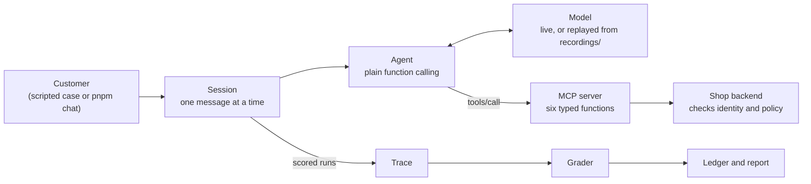

# desk-agent

A customer-support agent for a small Romanian shop, delivered the way a forward-deployed engineer delivers one. The test set came first. The agent came second and was tuned only on its tuning set. The results come from a set that nobody who tuned the agent had read. Every scoring run and every reader's verdict is committed, and the commands below regrade them into each number in the results. The tuning climbs are recorded step by step in the design, from their run logs.

## The problem

Studio Cobalt is an invented Bucharest print shop. One person answers every customer message, in Romanian (often without diacritics) or in English, and sometimes in both within one conversation. Most messages are routine: where is my order, change the address, cancel, return, a damaged print. The rest need the owner: a commission, a tattoo booking, a complaint, a refund above 1,000 lei.

The agent takes the routine messages and hands the rest to that person with a summary they can act on. It must never do what costs the shop money or trust: file a request the policy forbids, act for a customer who is not verified, disclose an order to a stranger, or promise what only staff decide. [The scope](docs/scope.md) states the policy, the three ways a conversation may end (resolved, handed over, refused) and what counts as a wrong action.

## How it works

- **Six functions, behind a real MCP server:** order lookup, account lookup, policy check, file a request for staff approval, amend a pending request, and hand over to a person. The functions enforce the policy and the identity check themselves. A request the policy forbids fails inside the function, whatever the model was told.
- **The agent** is about 120 lines of plain function calling, plus a 45-line system prompt, with no agent framework, on two models from one vendor: a cheaper one (`plain-gpt-6-luna`) and a stronger one (`plain-gpt-6.2-sol`). Both use the same code and the same prompt. The prompt says how to behave and holds no shop facts, which come from the functions.
- **A comparison loop** (`sdk-*`) runs the same prompt and functions through the AI SDK. It runs on the two GPT models and on two Claude models at matching token prices, so the framework and the vendor can each be measured. The `-tuned` Claude agents add one section, tuned for them, to the end of the shared prompt.
- **The runner** plays each case through the same session and MCP path a live chat uses. **The grader** checks the outcome, the requests on file, exact phrases and the reply language. The requests and any handover come from the accepted function calls in the trace. Only the choice between resolved and refused comes from the status the agent declares with each reply.
- **The ledger** records every scoring run with its commit and a hash of its cases and its code. **The report** grades again every saved run on each set's current cases with the latest scored code, and refuses to print a number that no longer matches its ledger line.

[The design](docs/design.md) explains each choice and the alternatives it beat.

## How it was measured

There are three sets, written by several authors, each a language model working from the scope. The author of each scored set saw no other set, and a model from another vendor checked each new scored set against the scope. The tuning set covers every category of [the test plan](docs/scope.md#test-plan).

| Set | Conversations | Used for |
| --- | ---: | --- |
| Tuning, `cases/tuning/` | 42 | Changing the prompt and the code. It holds the first tuning set and the former validation set, whose expected outcomes reached the person who later changed the policy, and five later cases with long conversations and amended requests. 26 Romanian and 16 English. |
| Validation, `cases/held-out/` | 36 | Checking a change after tuning. It holds the former final set, whose scores were published, and 18 new cases from another author. 22 Romanian and 14 English. Nobody who tuned the agent has read it. |
| Final, `cases/final/` | 36 | Scoring only. A new author wrote it from the scope and saw neither other set. 21 Romanian and 15 English. Nobody who tuned the agent has read it. |

Every model agent ran each scored set three times from a clean tree, and the deterministic keyword baseline once. One run moves by up to five cases from the next, so the tables report the total, the share and the lowest and highest count in one run.

## Results

On the final set, 36 conversations scored three times for each agent, by the automatic grader:

- **The stronger GPT model passed 104 of 108 conversations (34 to 35 per run), and the cheaper one 99 of 108 (32 to 34).** The keyword baseline passed 12 of 36.
- **The GPT agents took no wrong action the grader can detect** in 864 scored conversations, across both scored sets and both loops. The Claude agents took a wrong action in 6 of 864, each time a request the case did not expect. Every request any agent tried that the policy forbids or that an unverified customer asked for was refused inside the function.
- **The stronger model costs about 55 times as much per conversation** ($0.0223 against $0.0004), with a median model time per turn of 2.3 s against 1.8 s.
- **On the validation set both plain GPT agents passed 102 of 108.**
- **The Claude models trail at the same prices.** With the shared prompt alone, both pass 74 of 108 final conversations. With their tuned section, the larger passes 82 and the smaller 80.

The grader cannot see a false promise, a fact with no source or a handover made too early. Two readers judged the newest final run of each of the eight model agents, 288 conversations, against [a rubric](docs/judging.md), without knowing which agent wrote each one. Each conversation showed any customer messages that a handover cut off, so a reader could judge an early handover. Both readers are language models from vendors other than the agents' two vendors. Reader G judged all 288. Reader M judged the first 112 of the shuffled packet before its quota ran out.

| Acceptable on the final set, newest run | Automatic grader | Blind reader G (Grok 4.7) | Blind reader M (Gemini 4 Hydrogen) |
| --- | ---: | ---: | ---: |
| `plain-gpt-6-luna` | 32/36 | 30/36 | 11/14 |
| `plain-gpt-6.2-sol` | 34/36 | 32/36 | 9/9 |
| `sdk-gpt-6-luna` | 30/36 | 28/36 | 12/16 |
| `sdk-gpt-6.2-sol` | 35/36 | 31/36 | 16/17 |
| `sdk-claude-haiku-5-5` | 23/36 | 19/36 | 6/11 |
| `sdk-claude-haiku-5-5-tuned` | 27/36 | 23/36 | 16/18 |
| `sdk-claude-sonnet-5-5` | 23/36 | 20/36 | 9/16 |
| `sdk-claude-sonnet-5-5-tuned` | 26/36 | 25/36 | 8/11 |

- **Reader G rejected 34 conversations the grader passed,** and accepted 12 the grader failed. Its most often failed criterion is `handover`, a needless or early handover or a wrong reason or summary, in 54 conversations, 26 of them from the two larger Claude agents.
- **Reader G found a false promise in 2 conversations, both from the untuned smaller Claude model,** and a fact with no source in a function result in 15, 9 of them from the smaller Claude model. Neither reader found a disclosure before verification.
- **The readers agree with each other on 107 of the 112 conversations both judged** (Cohen's kappa 0.88). Reader G agrees with the grader on 242 of 288 (kappa 0.57), and reader M on 101 of 112 (kappa 0.70). Reader G is the stricter one.
- The readers are models, not people. A labelled human sample is the next check.

`pnpm audit:agreement --key results/audit/final/key.json --partial results/audit/final/reader-g.jsonl results/audit/final/reader-m.jsonl` reproduces these numbers from the committed verdicts. The blind reading of the earlier final set, before the sets moved, is in `results/audit/earlier-final/`.

**The stronger GPT model is the one to ship.** The grader and reader G both put it ahead of the cheaper one, by 5 conversations over three runs and by 2 on the newest run, and reader M accepted all 9 of its conversations that it read. It costs about 2 cents a conversation. The plain loop and the AI SDK loop score alike on it, so the plain loop stays.

[The final failure review](results/final-failures.md) and [the validation review](results/held-out-failures.md) trace every failure the grader found to its root cause on the sets as they were before they moved. Tuning is recorded step by step in [the design](docs/design.md#tuning), and [FAILURES.md](FAILURES.md) covers the tuning set.

This table is the output of `pnpm report --markdown`, and `pnpm check` fails when it differs. The keyword baseline is deterministic, so it has one run per set.

<!-- report table: start -->
| agent | runs | conversations | passed every check | resolved correctly | handover rate | wrong-action rate | blocked attempts | median turn | p95 turn | cost per conversation | code | latest commit | times scored |
| --- | ---: | ---: | ---: | ---: | ---: | ---: | ---: | ---: | ---: | ---: | --- | --- | ---: |
| rule-based | 1 | 36 | 12/36 (33%), per run 12 | 2/36 (6%), per run 2 | 21/36 (58%), per run 21 | 0/36 (0%), per run 0 | 11/36 (31%), per run 11 | 0.12 ms | 0.40 ms | $0.0000 | 992cfa5cb859 | 85445c9 | 2 |
| plain-gpt-6-luna | 3 | 108 | 99/108 (92%), per run 32–34 | 44/108 (41%), per run 14–15 | 30/108 (28%), per run 10 | 0/108 (0%), per run 0 | 3/108 (3%), per run 1 | 1790.42 ms | 3464.66 ms | $0.0004 | 992cfa5cb859 | 9a4b9c3 | 6 |
| plain-gpt-6.2-sol | 3 | 108 | 104/108 (96%), per run 34–35 | 45/108 (42%), per run 15 | 32/108 (30%), per run 10–11 | 0/108 (0%), per run 0 | 13/108 (12%), per run 4–5 | 2271.31 ms | 5319.66 ms | $0.0223 | 992cfa5cb859 | 3652d0d | 6 |
| sdk-gpt-6-luna | 3 | 108 | 96/108 (89%), per run 30–34 | 40/108 (37%), per run 12–14 | 32/108 (30%), per run 10–12 | 0/108 (0%), per run 0 | 4/108 (4%), per run 1–2 | 1804.38 ms | 3578.09 ms | $0.0004 | 992cfa5cb859 | f666ffc | 6 |
| sdk-gpt-6.2-sol | 3 | 108 | 104/108 (96%), per run 34–35 | 45/108 (42%), per run 15 | 32/108 (30%), per run 10–11 | 0/108 (0%), per run 0 | 11/108 (10%), per run 3–5 | 2276.44 ms | 5371.94 ms | $0.0217 | 992cfa5cb859 | 1041821 | 6 |
| sdk-claude-haiku-5-5 | 3 | 108 | 74/108 (69%), per run 23–27 | 35/108 (32%), per run 11–13 | 37/108 (34%), per run 9–14 | 1/108 (1%), per run 0–1 | 4/108 (4%), per run 1–2 | 2177.85 ms | 5864.47 ms | $0.0029 | 992cfa5cb859 | d8799e8 | 6 |
| sdk-claude-sonnet-5-5 | 3 | 108 | 74/108 (69%), per run 23–27 | 34/108 (31%), per run 10–13 | 60/108 (56%), per run 18–21 | 0/108 (0%), per run 0 | 9/108 (8%), per run 2–4 | 2361.61 ms | 7483.57 ms | $0.0544 | 992cfa5cb859 | 2e4c155 | 6 |
| sdk-claude-haiku-5-5-tuned | 3 | 108 | 80/108 (74%), per run 26–27 | 29/108 (27%), per run 9–10 | 33/108 (31%), per run 10–12 | 0/108 (0%), per run 0 | 4/108 (4%), per run 1–2 | 2085.80 ms | 5026.62 ms | $0.0029 | 992cfa5cb859 | 61522b7 | 6 |
| sdk-claude-sonnet-5-5-tuned | 3 | 108 | 82/108 (76%), per run 26–29 | 36/108 (33%), per run 11–14 | 51/108 (47%), per run 14–20 | 1/108 (1%), per run 0–1 | 10/108 (9%), per run 3–4 | 2668.27 ms | 8158.44 ms | $0.0575 | 992cfa5cb859 | 0cb7bab | 6 |

Final set, cases/final. Each row covers every scored run of one agent on the set's current case files with the same code as the latest of them, each regraded and matched to its line in results/ledger.jsonl. A count is the total over those runs, its share, and the lowest and highest count in one run. Turn times are nearest-rank over every turn of those runs. Code is the start of the SHA-256 of src/, package.json, pnpm-lock.yaml and the set's fixtures. Times scored counts the agent's lines for this set in the ledger, also those scored on earlier case files, which no row covers.

| agent | runs | conversations | passed every check | resolved correctly | handover rate | wrong-action rate | blocked attempts | median turn | p95 turn | cost per conversation | code | latest commit | times scored |
| --- | ---: | ---: | ---: | ---: | ---: | ---: | ---: | ---: | ---: | ---: | --- | --- | ---: |
| rule-based | 1 | 36 | 20/36 (56%), per run 20 | 8/36 (22%), per run 8 | 23/36 (64%), per run 23 | 0/36 (0%), per run 0 | 6/36 (17%), per run 6 | 0.13 ms | 0.56 ms | $0.0000 | d1a47702610f | 99db4b5 | 4 |
| plain-gpt-6-luna | 3 | 108 | 102/108 (94%), per run 34 | 40/108 (37%), per run 13–14 | 36/108 (33%), per run 12 | 0/108 (0%), per run 0 | 4/108 (4%), per run 1–2 | 1827.59 ms | 3342.25 ms | $0.0003 | d1a47702610f | 19fb763 | 6 |
| plain-gpt-6.2-sol | 3 | 108 | 102/108 (94%), per run 33–35 | 41/108 (38%), per run 13–14 | 34/108 (31%), per run 11–12 | 0/108 (0%), per run 0 | 8/108 (7%), per run 2–3 | 2574.12 ms | 5477.54 ms | $0.0184 | d1a47702610f | 424543f | 6 |
| sdk-gpt-6-luna | 3 | 108 | 98/108 (91%), per run 32–33 | 40/108 (37%), per run 13–14 | 37/108 (34%), per run 11–13 | 0/108 (0%), per run 0 | 3/108 (3%), per run 1 | 1902.51 ms | 3334.60 ms | $0.0003 | d1a47702610f | 9a7769a | 6 |
| sdk-gpt-6.2-sol | 3 | 108 | 103/108 (95%), per run 33–35 | 41/108 (38%), per run 13–14 | 35/108 (32%), per run 11–12 | 0/108 (0%), per run 0 | 9/108 (8%), per run 3 | 2681.46 ms | 5291.72 ms | $0.0180 | d1a47702610f | 2a18886 | 6 |
| sdk-claude-haiku-5-5 | 3 | 108 | 75/108 (69%), per run 22–27 | 31/108 (29%), per run 9–11 | 29/108 (27%), per run 8–12 | 1/108 (1%), per run 0–1 | 3/108 (3%), per run 1 | 2032.15 ms | 4846.46 ms | $0.0022 | d1a47702610f | 7e5300c | 6 |
| sdk-claude-sonnet-5-5 | 3 | 108 | 84/108 (78%), per run 27–30 | 24/108 (22%), per run 7–9 | 59/108 (55%), per run 18–21 | 1/108 (1%), per run 0–1 | 4/108 (4%), per run 1–2 | 2347.22 ms | 8380.14 ms | $0.0466 | d1a47702610f | 5364ac7 | 6 |
| sdk-claude-haiku-5-5-tuned | 3 | 108 | 69/108 (64%), per run 21–26 | 24/108 (22%), per run 7–9 | 34/108 (31%), per run 9–13 | 1/108 (1%), per run 0–1 | 3/108 (3%), per run 1 | 2325.87 ms | 4994.23 ms | $0.0022 | d1a47702610f | b48a007 | 6 |
| sdk-claude-sonnet-5-5-tuned | 3 | 108 | 89/108 (82%), per run 27–32 | 31/108 (29%), per run 8–12 | 48/108 (44%), per run 15–18 | 1/108 (1%), per run 0–1 | 4/108 (4%), per run 1–2 | 2228.51 ms | 6929.32 ms | $0.0468 | d1a47702610f | 3bdf79f | 6 |

Validation set, cases/held-out. Each row covers every scored run of one agent on the set's current case files with the same code as the latest of them, each regraded and matched to its line in results/ledger.jsonl. A count is the total over those runs, its share, and the lowest and highest count in one run. Turn times are nearest-rank over every turn of those runs. Code is the start of the SHA-256 of src/, package.json, pnpm-lock.yaml and the set's fixtures. Times scored counts the agent's lines for this set in the ledger, also those scored on earlier case files, which no row covers.
<!-- report table: end -->

"Resolved correctly" is low by design. A conversation the scope sends to a person, or one the agent must refuse, is counted as handed over or refused, not resolved.

## Decisions and the numbers behind them

The scores in this table come from the scored runs on today's sets, unless a row says otherwise.

| Decision | What measured it |
| --- | --- |
| The functions enforce the policy and the identity check, not the prompt. | Every request the policy forbids, or that an unverified customer asked for, was refused inside the function. The keyword baseline tried one in 11 final and 6 validation conversations, and the model agents in 96 across both sets. The GPT agents took no wrong action in 864 scored conversations. The Claude agents filed a request the case did not expect, within the policy, in 6 of 864. |
| Define a complaint and a dispute in the scope instead of tuning the prompt around them. | On the first tuning set, all 12 tuning failures of the stronger model at that point were handovers marked as complaints. After the scope said what a complaint is, it passed 18 to 19 of 19. |
| Check the reply language with two word lists instead of a model or a package. | It reads 90 of the 99 tuning customer turns right, none wrong and 9 as unsure, and an unsure reading never fails a case. |
| Score three runs per agent and report the spread. | One run moves by up to five cases from the next. A single run cannot show a change worth one case. |
| Quote the final set, not the tuning set. | Whoever tuned the prompts read every tuning case. The plain GPT agents pass 40 to 42 of 42 tuning conversations per run, and 32 to 35 of 36 final conversations, which nobody who tuned read. |
| Regrade every saved run in the report, and check the README against it in `pnpm check`. | A grader change that moves a published number stops the report with the field and both values. |
| Replay recorded model responses offline by default. | The check, CI and the Docker run need no key and no network, and the replay sends byte for byte the requests it recorded. |
| Keep the plain loop rather than the AI SDK loop. | On the same two models, the SDK loop (`sdk-gpt-*`) passes 96 and 104 of 108 final conversations to the plain loop's 99 and 104, and 98 and 103 of 108 validation conversations to 102 and 102. That difference is inside the run-to-run spread, too small to justify a dependency whose loop and retries sit outside this repository. |
| Stay on the tuned vendor rather than switching at the same price. | Run with the prompt unchanged, the price-matched Claude models pass 74 and 74 of 108 final conversations, against 99 and 104 for the GPT models. The larger Claude model hands over 60 of 108. |
| Give both vendors the same tuning climb before comparing them. | Both climbed again on the grown tuning set under one rule written before any run ([the second climb](docs/design.md#the-second-climb-the-same-for-both-vendors)). GPT's starting prompt already met the stop condition. Claude's four steps were all reverted, so the tuned Claude agents keep the first climb's rules. Those rules take the larger Claude model from 74 to 82 of 108 final conversations and from 84 to 89 on the validation set, and the smaller one from 74 to 80 on the final set and from 75 down to 69 on the validation set. Even tuned, both trail the GPT models. |
| Recommend a model only after a blind reading. | The grader passes 230 of the 288 newest final conversations. Reader G accepts 208 and rejects 34 that the grader passed, most for a needless or early handover, which the grader cannot see. |

## Limits

These are the weak spots, stated before a reader finds them.

- **The conversations are synthetic and scripted.** Language models wrote them from the scope. A scripted customer cannot react to what the agent says.
- **The sets are small.** One conversation of a 36-conversation set is 2.8 points of one run. Three runs narrow the noise but do not remove it.
- **The sets differ in difficulty.** The keyword baseline passes 14 of 42 tuning conversations, 20 of 36 validation conversations and 12 of 36 final conversations.
- **"Test set first" means before the model agent.** The keyword baseline existed before the cases. One tuning expectation changed after review, and two tuning cases were repaired, one after a policy correction made it unpassable and one whose middle question the policy sends to a person. [FAILURES.md](FAILURES.md) and [the design](docs/design.md#the-second-climb-the-same-for-both-vendors) record them.
- **Half the validation set has been scored before.** Its 18 older cases were the final set until the sets moved, so their numbers were published, though nobody who tuned the agent has read them.
- **The case authors, the checker and the readers share vendors.** Grok 4.7 wrote the final set and is blind reader G. A Gemini model wrote the 18 newer validation cases, and Gemini 4 Hydrogen is reader M. A GPT model, the vendor of the GPT agents, checked both new sets against the scope.
- **Reader M judged 112 of the 288 final conversations.** Its quota ran out there. The packet is shuffled, so the 112 are a random sample across all eight agents, and every comparison with reader M uses those 112 only.
- **Neither climb kept a step.** Both vendors climbed under the same rule. GPT's starting prompt already met the stop condition, and Claude's four steps were reverted. The last one fixed the three cases the smaller Claude model failed in every run and raised its mean by four cases, but one run fell short of the bar. The Claude rows show where a stopped climb left that family, not what it can do.
- **A delivery change takes any nonblank text as its address.** Twice on the validation set the larger Claude model filed one with a placeholder such as "To be provided by the customer", and the function accepted it.
- **Text only.** The GPT agents take about 1.8 to 2.7 s per turn in the median and 3.3 to 5.5 s at the 95th percentile, and the Claude agents up to 8.4 s. That leaves out tool time. It is workable for chat and too slow for a voice line.
- **The language check passes what it cannot read.** A short reply or a mixed one counts as unsure and never fails.
- **A request can be amended only in the conversation that filed it.** An order shows no earlier claim, so a wish the customer adds in a later conversation needs a person.
- **Log redaction is by pattern and by the names the functions returned.** It masks emails, phone, card and IBAN numbers, street addresses and each customer name a function returned in the chat. A name the customer only types, such as a friend's, stays.
- **The framework comparison covers one framework.** The `sdk-*` agents run one AI SDK loop, recorded at the wire like the plain agent. Other frameworks were not measured.
- **Today's final failures are not yet traced to their causes.** The failure reviews linked above cover the sets as they were before they moved.

## Run it

With Docker Engine and Docker Compose running, from a fresh clone:

	docker compose run --rm check

Building the image downloads Node and the dependencies. The check itself runs with no network and needs no key. It typechecks, runs the tests, replays the tuning set for the rule-based agent and every model agent with a recordings directory, prints the report as a plain-text table with the same numbers as the table above, and checks that the README's table matches the report. `pnpm report --markdown` prints it in the README's format. CI runs the same steps on every pull request and every push to `main`.

Without Docker, with Node 24.3 or later and pnpm 11.18.0:

	pnpm install --frozen-lockfile
	pnpm check                                                     # the same steps as the container
	pnpm chat --agent plain-gpt-6-luna --replay ro-unde-e-coletul  # watch one tuning conversation, offline
	pnpm mcp                                                       # serve the six functions over stdio

Live chats and any command with `--record` call a paid provider and need a key, in `.env` or the environment. Scoring without `--record` replays the committed recordings. [The verification skill](.agents/skills/verify-desk-agent/SKILL.md) lists every command, what it proves and its fences.

## Where things are

| Path | What it holds |
| --- | --- |
| `docs/scope.md` | The client, the policy, the outcomes, the wrong actions and the test plan. |
| `docs/design.md` | Every design choice with its alternatives, the tuning steps, and the full list of limits. |
| `docs/judging.md` | The rubric a reader applies to one conversation. |
| `src/` | About 3,850 lines of TypeScript: shapes, functions, MCP server, agents, runner, grader, report, audit tools. |
| `cases/`, `fixtures/` | The three sets and their orders. |
| `recordings/` | The last tuning run of each model agent, replayed offline. |
| `results/` | Every scoring run, the ledger, and the failure reviews. |
